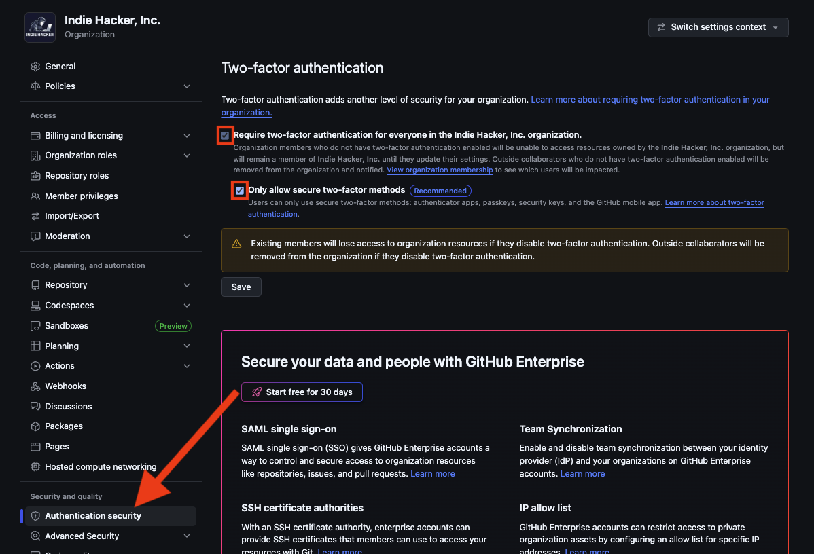

# 🎊 セットアップ

> ⚠️ **前提** : GitHub Team プランを契約していること

Organization の設定は Terraform（[`terraform/github/`](../terraform/github/)）で管理する。設定の値と、なぜその値にしているかは `.tf` のコメントに書いている。
このドキュメントには、API で変えられないため手作業で行う設定と、Terraform の使い方を書く。

| 設定 | 管理する場所 |
|:--|:--|
| ベース権限・リポジトリ作成・fork の禁止 | [`organization.tf`](../terraform/github/organization.tf) |
| ルールセット（branch / push / tag） | [`rulesets.tf`](../terraform/github/rulesets.tf) |
| 実行できる action の制限・`GITHUB_TOKEN` のデフォルト権限 | [`actions.tf`](../terraform/github/actions.tf) |
| 二要素認証・組織シークレット・Claude GitHub App・Immutable releases | 手作業（「0.」「4.」「5.」） |

## 0. 🏢 Organization の基本設定

<details><summary>🫆 <b>二要素認証を必須にする</b>（手作業）</summary>

🔗 Organization → Settings → Authentication security

API で変えられないため、UI で設定する。設定されていないと `terraform plan` で警告が出る。


*チェックを入れてください*

⚠️ 二要素認証未設定のメンバーは org のリソースへアクセスできなくなり、outside collaborator は org から削除されるため、事前に周知すること
```text
【要対応・期限 ◯月◯日】GitHub の二要素認証(2FA)を設定お願いします。

◯月◯日より、GitHub にて二要素認証を必須化します。
期限までに設定がない場合、Organization のリポジトリなどのリソースにアクセスできなくなります。
(設定すればすぐにアクセスが回復します)

■ 設定手順(5 分程度)
1. https://github.com/settings/security を開く
2. "Two-factor authentication" の [Enable two-factor authentication] をクリック
3. 認証方法として「パスキー / セキュリティキー」「認証アプリ」「GitHub Mobile」のいずれかを選ぶ  ※ SMS は推奨しません

■ 設定済みか確認するには
https://github.com/settings/security を開き、"Two-factor authentication" が
有効(緑のチェック)になっていれば対応済みです。
```

</details>

---
## 1. 🏗️ Terraform で設定を反映する

apply は Organization の owner が手元から行う。state は手元のファイル（`terraform/github/terraform.tfstate`）に置く。
state には設定の全体が平文で入るため、コミットしない（`.gitignore` に入れている。`*.tfstate` は push ルールセットでも拒否されるが、`*.tfstate.backup` は拒否されない）。

**準備**

```shell
mise install                          # terraform を入れる
gh auth refresh -h github.com -s admin:org  # provider は gh の token を使う
terraform -chdir=terraform/github init
```

**初回（と、state を失くしたとき）** : 今の設定を state に取り込む。GitHub の設定は変わらない。

```shell
terraform/github/import.sh
```

最後に「Terraform で管理していないルールセット」が出たら、名前が `rulesets.tf` と違っていないかを確かめる。違っていると、apply で同じ内容のルールセットがもう 1 つ作られる。

**設定を変えるとき** : `.tf` を変える PR を作り、マージしてから main で反映する。

```shell
terraform -chdir=terraform/github plan   # 差分が意図したものだけであることを確かめる
terraform -chdir=terraform/github apply
```

- `github_organization_settings` と Actions の設定は `prevent_destroy` にしている。destroy すると、billing_email が `email@example.com` に、各設定が既定値に戻るため
- `organization.tf` は、ベース権限・リポジトリ作成・fork の 3 つだけを管理し、ほかの項目（billing_email・プロフィール・新規リポジトリのセキュリティ機能など）は今の値をそのまま渡す

---
## 2. 📚 ルールセット

| ルールセット | 対象 | 内容 |
|:--|:--|:--|
| 🚫 main への直接 push 禁止 | 全 repo の default branch | 削除・force push の禁止、PR の必須化 |
| ✅ PR の承認を必須化 | 全 repo の default branch | 人間の承認 1 名以上。bypass は Renovate 用 GitHub App（`renovate-<org 名>`。PR のときだけ）と org 管理者 |
| 🛡️ 脆弱性・IaC 設定ミス検知 | 全 repo の default branch | `security.yml` の成功を必須にする |
| ✏️ スタイルチェック | 全 repo の default branch | `style.yml` の成功を必須にする |
| 🚫 機密ファイルの push 禁止 | 全 repo | `.env`・秘密鍵・`*.tfstate` などの push を拒否する |
| 🔒 リリースタグの変更禁止 | この repo の `v*` タグ | タグの更新・削除を禁止する（「5.」） |
| 🏷️ リリースタグの作成を制限 | この repo の `v*` タグ | タグの作成を禁止する。bypass は GitHub Actions（Release ワークフローの `GITHUB_TOKEN`）だけ（「5.」） |

> ⚠️ 承認者本人が作成した PR は自己承認できないため、「✅ PR の承認を必須化」の bypass に org 管理者を入れている。

### 🛡️ 脆弱性・IaC 設定ミス検知

`security.yml` は次を検査する。常に動くのは `scan` の job だけで、PR のコードは実行しない（イメージのビルドは `scan-image` の job で行う）。

| 検査 | 内容 |
|:----|:----|
| Gitleaks | PR のコミットに混入したシークレット（圧縮ファイルの中も含む） |
| ghalint | ワークフローのセキュリティポリシー（permissions 未設定・action の SHA 未固定など）。ワークフローを変更したときだけ |
| zizmor | GitHub Actions の設定の脆弱性（severity HIGH 以上）。ワークフロー・action 定義などを変更したときだけ |
| Semgrep | アプリケーションコード（ルールセット `p/default`・severity ERROR）。PR で新規に増えた検出のみ |
| Trivy | 依存パッケージの脆弱性と IaC の設定ミス（MEDIUM 以上・修正版があるもの）、Dockerfile からビルドしたイメージの脆弱性。Renovate の PR は報告だけで失敗しない |

### ✏️ スタイルチェック

`style.yml` は次を検査する。常に動くのは `lint` の job だけで、ほかの job は対象のファイルがあるときだけ動く。

| job | 検査内容 |
|:----|:--------|
| `lint` | ワークフロー定義の構文（actionlint）・シェルスクリプトの lint（shellcheck）・Terraform の書式（terraform fmt）と lint（tflint。terraform ruleset の `all` プリセット + aws / google ruleset。設定は全リポジトリ共通で固定）・Python の規約（uv での依存管理）・lint・書式・セキュリティ（ruff の `S` ルール） |
| `terraform` | Terraform の validate・lock ファイルと `required_providers` の整合・test（`*.tftest.hcl`） |
| `python` | Python の型（Pyright）・モジュールの依存関係（lint-imports）・不要なパッケージ（deptry）。`uv.lock` のあるディレクトリごと |
| `typescript` | TypeScript の規約（Bun での依存管理）・lint・書式・型・未使用パッケージ |
| `bundle-size-measure` / `bundle-size-comment` | フロントエンド（Next.js / Astro）の JS・CSS の gzip 後のサイズの増減を PR にコメント（報告だけで失敗しない） |

> 必須ワークフローは、対象 repo のコードを実行してよい（`style.yml` の `python` / `typescript` job の `uv sync` / `bun install` による依存導入と、その環境上で動く Pyright / lint-imports / deptry / Biome / knip / tsc、`terraform` job の `terraform init` / `validate` / `test` が実行する provider・module、`bundle-size-measure` job の `bun install` とビルドなど）。ただし次を守る。
> - `permissions` は read のみとし、secrets を使わない（例外: `terraform` job にだけ `id-token: write` を付け、private の Module Registry（registry.fastship.jp）の ID トークンを [registry-fastship-action](https://github.com/theindiehacker/registry-fastship-action) で取得して、`terraform init` の step にだけ渡す。fork からの PR では取得できない。PR にコメントする `bundle-size-comment` job にだけ `pull-requests: write` を付ける。この job は checkout せず、PR のコードを動かさない）。トリガーは `pull_request` とし、`pull_request_target` では動かさない
> - `actions/checkout` は `persist-credentials: false` にする
> - PR のコードを実行する処理は `lint` と別の job にし、対象のファイルがあるときだけ動かす（常に動く `lint` の job では PR のコードを実行しない）
> - repo の環境に依存して失敗し得る前提は、下の「導入時の前提」に書く。対応できない repo は「例外運用」で外す
>
> この条件なら、PR のコードが動いても、その repo の通常の CI と同じで越えられる権限の境界は無い。`terraform` job の PR のコードは ID トークンを取得できるが、ブランチに push できる人は自分のワークフローでも取得できる（fork からの PR では、どちらも取得できない）。
>
> バンドルサイズは、PR のコードを動かす計測の job（`bundle-size-measure`）を read のみにし、その結果を artifact で受け取ってコメントする job（`bundle-size-comment`）だけに `pull-requests: write` を付ける。依存パッケージが侵害されても write のトークンは読めず、コメントの投稿先もその PR に固定される。public repo の fork からの PR では、トークンが read のみになるためコメントされない（マージは止めない）。
>
> 検査の対象や厳しさ、src レイアウトの自パッケージの解決は、対象 repo の設定ファイル（`[tool.pyright]` / `pyrightconfig.json` / `[tool.deptry]` / `[build-system]` / `biome.json` / `knip.json` / `tsconfig.json` など）に従う。
> ただし tflint の設定は `style.yml` に埋め込んで固定しており、対象 repo の `.tflint.hcl` とインラインの `tflint-ignore` コメントは使えない。

**導入時の前提** : 次に当てはまる repo は、対応するまで必須チェックが fail する。

1. Pyright の型エラーがある（検査対象と厳しさは `uv.lock` のあるディレクトリの `[tool.pyright]` / `pyrightconfig.json` に従い、workspace のメンバーの設定は読まない。設定が無ければそのディレクトリ全体を standard モードで検査し、別の `uv.lock` を持つ入れ子のディレクトリは除く。設定を書いた場合は、入れ子のディレクトリを `exclude` に入れる。`extends` で読む共有の設定は `pyright*.json` という名前にする (それだけを変えた PR でも検査が動く)。`include` に存在しないパスがある・知らない設定や不正な値がある・利用者の設定で検査するファイルが 0 件のときも fail する。mypy の設定は使わない）
2. `autogenerated by uv` で始まらない `requirements*.txt` を依存管理に使っている（`pyproject.toml` の隣にあるもの、`pyproject.toml` が無い repo では Python コードがある場合のみ対象）
3. `bun.lock` をコミットしていない（`bun install --frozen-lockfile` が失敗する）
4. `@biomejs/biome` / `knip` / `typescript` を依存（dependencies か devDependencies）に持たない（`package.json` がある repo のみ対象）。`bunfig.toml` の `[install]` で `production = true` か `dev = false` にしている repo は、devDependencies を入れないため dependencies に持つ
5. ruff の `S` ルール（bandit 相当。`S101` を除く）に違反している（repo の `ignore` では外せない。誤検知は `# noqa: Sxxx` か `per-file-ignores` で個別に外す）
6. `.terraform.lock.hcl` に linux_amd64 のハッシュが無い（`terraform init -lockfile=readonly` で provider を検証できない。`terraform providers lock -platform=linux_amd64 -platform=darwin_arm64` などで追記する）
7. `terraform test` がクラウドの認証情報を必要とする（認証情報は渡さないため、`command = plan` と `mock_provider` で完結するテストだけが通る）
8. Terraform 1.16.0（`style.yml` で固定）で動かない `required_version` を宣言している
9. tflint（`style.yml` の固定設定）の違反がある、または `.tf` に `tflint-ignore` コメントがある（違反は変更したディレクトリのみ検査するが、`tflint-ignore` の禁止は repo 全体が対象）
10. registry.fastship.jp のモジュールを使っているのに、その repo の org が registry.fastship.jp の契約企業に登録されていない、または fork からの PR である（`terraform init` が 401 で失敗する）

バンドルサイズの計測は、サイズが増えても、ビルドの失敗やタイムアウト（40 分）でも fail しないため、前提は無い。ただし次の場合は計測されない、または一部だけが計測される。

- PR がフロントエンドのディレクトリ配下を変更していない（2 回のビルドを省くため）
- `package.json` と同じディレクトリに `bun.lock` / `bun.lockb` が無い（workspace の子など）
- ビルドに環境変数や secrets が要る（PR に「計測できませんでした」とコメントされる）
- Next.js を webpack でビルドしている（計測するのは Turbopack の出力先 `.next/static/chunks/` だけで、`.next/static/css/` の CSS は含まない）
- Next.js の `distDir` を変えている、または Astro の adapter が出力先を `dist/` 以外にしている（ファイルが見つからず、増減なしと出る）

**例外運用** : ランナーで依存を導入できない repo（private index の認証が必要など）が出た場合だけ、`rulesets.tf` の `style_check` の `conditions.repository_name.exclude` にその repo を足して apply し、対象から外す。規約・lint・書式の検査も併せて外れる。

---
## 3. ⚙️ GitHub Actions のセキュリティ設定

実行できる action は、Organization のもの・GitHub 製・`actions.tf` の許可リストに限っている。各リポジトリが新しい外部 action を使う場合は、許可リストに足して apply する（SHA ピン留めは各ワークフロー側で行う）。

`GITHUB_TOKEN` のデフォルト権限は read で、PR を承認できない。`GITHUB_TOKEN` による自己承認で、承認を必須にするルールセットが迂回されるのを防ぐ。`permissions:` を明示しているワークフロー（本リポジトリのものを含む）には影響しない。

---
## 4. 🧠 Claude ワークフロー

### 4.1 組織シークレットを登録する（手作業）

値が tfstate に平文で入るため、Terraform では管理しない。以下の**どちらか一方**を、Repository access を `Private repositories` にして登録する。public リポジトリにはリポジトリシークレットとしても登録しない（fork PR の差分経由でトークンを読み出される恐れがあるため）。

| Name | 値 |
|:-----|:--|
| `CLAUDE_CODE_OAUTH_TOKEN` | `claude setup-token` で発行した OAuth トークン（Pro / Max プラン） |
| `ANTHROPIC_API_KEY` | Anthropic API キー |

```shell
gh secret set CLAUDE_CODE_OAUTH_TOKEN --org theindiehacker --visibility private  # 値は標準入力から入れる
```

### 4.2 Claude GitHub App をインストールする（手作業）

https://github.com/apps/claude を Organization にインストールし、Repository access を `All repositories` にする（App のインストールは API で行えない）。

### 4.3 各リポジトリに呼び出し側のワークフローを追加する

1. 最新のリリースタグ（例: `v1.0.0`）のコミット SHA を確認する（`^{}` の行があればそちらを使う）

```shell
git ls-remote https://github.com/theindiehacker/github-workflows 'refs/tags/v1.0.0^{}' 'refs/tags/v1.0.0'
```

2. [`.github/workflows/self-claude.yml`](../.github/workflows/self-claude.yml) を `.github/workflows/claude.yml` としてコピーし、各 job の `uses:` を 1. の値で書き換える

```diff
-    uses: ./.github/workflows/claude-code-review.yml
+    uses: theindiehacker/github-workflows/.github/workflows/claude-code-review.yml@<SHA>  # v1.0.0
```

3. main にマージ後、PR を作るとコードレビューが自動で投稿されることを確認する (再レビューは PR に `/code-review` とコメントする)

セキュリティレビューは、コメント (`/security-review`) で頼んだときだけ動く。PR の作成時 (Draft は Ready にしたとき) にも動かすには、`security-review` job の `if` に `code-review` job と同じ `pull_request` の条件を足す (FastShip の `/dev:setup` が足す)。

リポジトリ全体のセキュリティ監査 (PR のレビューでは見ない、前からある問題を探す) は、GitHub Actions ではなく Claude Code on the web の[ルーティン](https://claude.ai/code/routines)で、[cloudflare/security-audit-skill](https://github.com/cloudflare/security-audit-skill) を使って行う。時間で切れず、対象のコードをコンテナの中で動かして確かめられ、結果がセッションに残るため。

1. https://claude.ai/code の入力欄の下の環境名 → **クラウド** → 環境の ⚙️ を開き、**セットアップスクリプト** に下を足して保存する。skill のコミットは固定している。上げるときは差分を読んでから SHA を書き換える

   ```bash
   {
     src=$(mktemp -d) &&
     git -C "$src" init -q &&
     git -C "$src" fetch -q --depth 1 https://github.com/cloudflare/security-audit-skill.git c1c8a8c1471069fb0e188eeaff69b8e8db6564a8 &&
     git -C "$src" checkout -q FETCH_HEAD &&
     mkdir -p ~/.claude/skills &&
     rm -rf ~/.claude/skills/security-audit &&
     cp -R "$src/skills/security-audit" ~/.claude/skills/
   } || echo "⚠️ security-audit skill を入れられませんでした" >&2
   ```

2. https://claude.ai/code/routines でルーティンを作る。リポジトリと 1. の環境を選び、スケジュールは月 1 回 (例: 毎月 1 日 9:17 JST)、プロンプトは下にする

   ```text
   security-audit skill で、このリポジトリ全体をフル監査して (profile は standard)。
   終わったら、confirmed で severity が critical・high・medium の指摘を、それぞれ `security-audit` ラベルの Issue にする。
   open の `security-audit` Issue と、not planned・duplicate で閉じた `security-audit` Issue と同じ指摘は起票しない。
   completed で閉じた Issue と同じ指摘は、今もコードに残っているときだけ起票し、元の Issue に触れる。
   リポジトリが public なら起票せず、結果はこのセッションにだけ残す。
   ```

3. 作ったら一度手動で実行し、セッションで監査が最後まで進み、Issue ができるかを確かめる

- 誤検知や許容するリスクは「Close as not planned」で閉じる。次回からは起票されない
- ルーティンは作った人の claude.ai アカウントに属し、その人の利用枠を使う。その人が抜けると止まるため、別の人が作り直す

> 💡 本リポジトリは `github-workflows` → `devops` → `github-workflows` と改名した。git clone や API は旧名からリダイレクトされるが、`uses:` はリダイレクトされず、旧名の `uses: theindiehacker/devops/...` はワークフローの起動時点で失敗する。そのため `theindiehacker/github-workflows/...` に書き換える（旧名 `devops` でリポジトリを作り直すと参照先が乗っ取られるため、旧名は再利用しない）。ruleset はリポジトリ名ではなく ID で紐付くため、改名後の再設定は不要

---
## 5. 🏷️ リリースタグ

呼び出し側が reusable workflow（「4.」）を `@<SHA>  # vX.Y.Z` で参照し、Renovate で更新できるようにするため、本リポジトリには semver のリリースタグを付ける。

**リリースの手順** : 🔗 本リポジトリ → Actions → **🏷️ Release** → **Run workflow**

1. Branch は `main` のまま、`bump` で上げるバージョン（下表）を選んで実行する
2. main の先頭のコミットに、次のバージョンのタグ `vX.Y.Z` と GitHub Release（リリースノートは前回のタグ以降の PR から自動生成）が作られる
3. 呼び出し側の Renovate が新しいタグを検出し、参照の更新 PR を作る

| bump | 対象 |
|:----|:----|
| `major` | 呼び出し側の変更が必要なもの（`on:`・job の `permissions`・`secrets`・`inputs` の追加や変更、トリガーのコメントの変更など） |
| `minor` | 呼び出し側の変更が不要な機能追加・挙動の変更（モデルの変更など） |
| `patch` | 不具合の修正、action・ツールの更新 |

- 前回のリリース以降に入った変更のうち、いちばん大きい区分を選ぶ。呼び出し側の挙動が変わらない変更（ドキュメントなど）だけならリリースしない
- タグがまだ無い場合は、`bump` に関係なく `v1.0.0` になる
- main の先頭にすでにタグが付いている場合は、何も作らずに失敗で終わる（新しい変更をマージしてから実行し直す）
- `main` 以外のブランチを選んだ場合は job が skip される
- タグを作れるのは GitHub Actions（`GITHUB_TOKEN`）だけで、直接の push や Claude App のトークンでは作れない（「🏷️ リリースタグの作成を制限」）。ただし write 権限を持つメンバーは、ワークフローを書き換えれば、レビューを経ないコミットにもタグを付けられる（呼び出し側ではマイナー・パッチの更新が自動マージされる）。write 権限は信頼できるメンバーだけに付与する
- 実行は 1 回ずつ行う。実行中に続けて 2 回以上実行すると、待機中の実行は最後の 1 回に置き換えられる

付けたタグは「🔒 リリースタグの変更禁止」（「2.」）で更新・削除できない。誤ったタグを付けた場合も付け替えず、修正を入れた次のバージョンを出す。

<details><summary><b>Immutable releases を有効にする</b>（手作業）</summary>

🔗 本リポジトリ → Settings → General → Releases

- ✅ **Enable release immutability**

公開済みの GitHub Release のタグとアセットを変更・削除できなくなる（有効化より前に作った Release には適用されない）。tag ruleset と合わせて、リリースタグが指すコミットを固定する。
最初のリリース（`v1.0.0`）の前に有効にしておく。Terraform の provider が対応していないため、UI で設定する。

</details>
